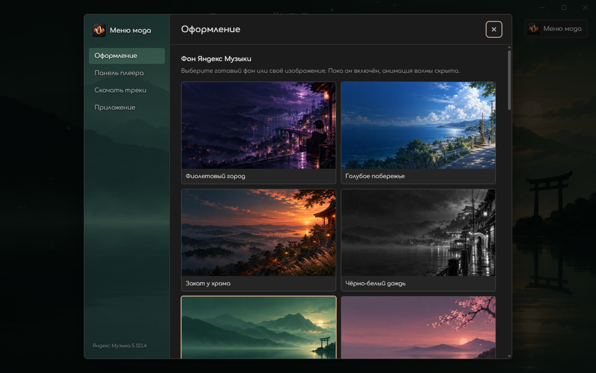
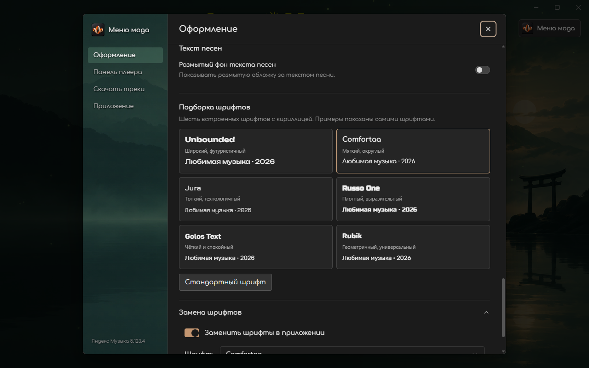

# Яндекс Музыка Мод 1.3.0

[Скачать установщик и portable-версию](https://github.com/EelinLp/Yandex-Music-Mod/releases/latest)

1. Скачайте `YandexMusicMod-Setup-1.3.0.exe` из релиза и установите.
2. Откройте «Яндекс Музыка Мод» через ярлык и войдите в аккаунт.
3. Настройки — кнопка «Меню мода» справа вверху.

Для portable-версии распакуйте архив целиком и запустите `Яндекс Музыка.exe`.

Полные исходники и скрипты сборки — `YandexMusicMod-Source-1.3.0.zip` в релизе.
