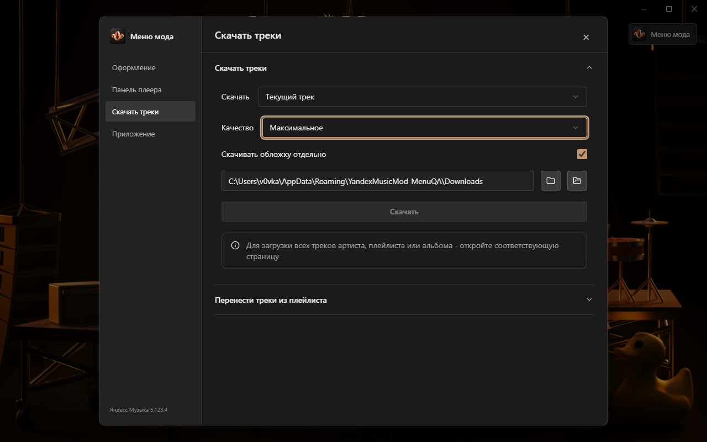
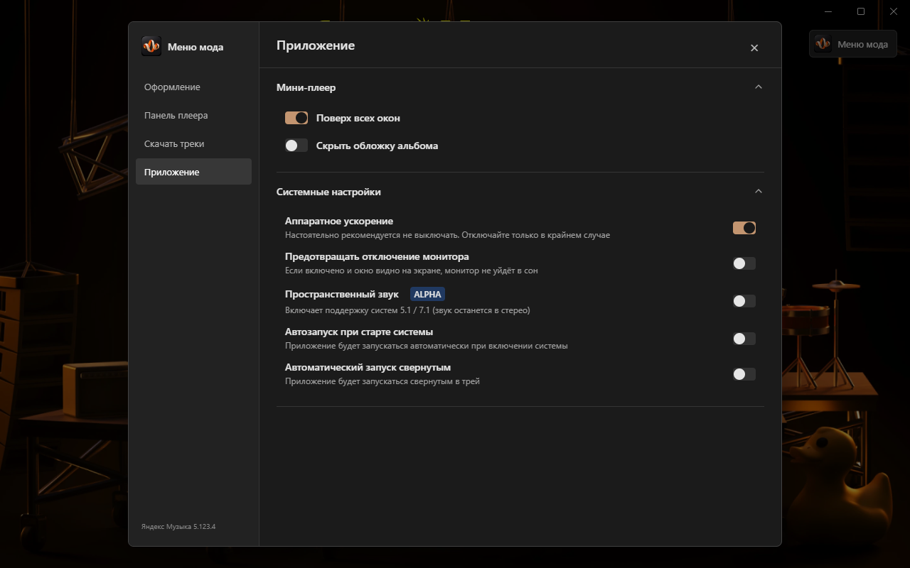

# Яндекс Музыка Мод

Мод для настольной Яндекс Музыки на Windows x64. Версия клиента в релизе — **5.123.4**.

[Скачать установщик](https://github.com/EelinLp/Yandex-Music-Mod/releases/latest) · [Все релизы](https://github.com/EelinLp/Yandex-Music-Mod/releases)

## Возможности

- **Панель плеера:** кодек и доступный битрейт трека, постоянный показ времени, расположение лайка и дизлайка, цвета и ширина панели.
- **Авто-выбор качества:** лучшее доступное качество по умолчанию.
- **Анимация Моей Волны:** частота кадров, интенсивность, реакция на музыку и сглаживание.
- **Визуальные эффекты:** снег, искры и лепестки с отдельными переключателями, настройкой количества и скорости.
- **Скачать треки:** загрузка музыки, выбор папки и сохранение обложек.
- **Перенести треки из плейлиста:** добавление треков плейлиста в избранное.
- **Мини-плеер:** отдельное окно, режим поверх остальных окон и управление обложкой.
- **Текст песен и шрифты:** выбор источника текста, размытый фон, замена шрифтов.

Без рекламных блоков мода и раздела разработчика. Названия основных функций сохранены из исходного мода.

## Скриншоты

### Оформление и эффекты

### Скачивание треков

### Мини-плеер и параметры приложения

## Как запустить

1. Скачайте **YandexMusicMod-Setup-1.0.0.exe** из [релиза](https://github.com/EelinLp/Yandex-Music-Mod/releases/latest).
2. Установите и откройте **«Яндекс Музыка Мод»** через ярлык.
3. Войдите в аккаунт. Панель открывается кнопкой **«Меню мода»** справа вверху.

Для portable-версии: полностью распакуйте ZIP и запустите **«Яндекс Музыка.exe»**.

## Исходники

Полный комплект исходников и скриптов сборки — **YandexMusicMod-Source-1.0.0.zip** в релизе.
Скачивание музыки сохраняет результат в MP3. Индикатор качества относится к воспроизводимому потоку.
Воспроизведение под личным аккаунтом не входило в автоматическую проверку сборки.

Проект основан на [Yandex-Music-Mod v2.23.2](https://github.com/Vzlomhik2005/Yandex-Music-Mod/releases/tag/v2.23.2).
В этой версии обновлены совместимость с клиентом, интерфейс, индикатор качества и эффекты.
Сведения об исходных компонентах — [NOTICE.md](NOTICE.md), лицензия мода — [LICENSE](LICENSE).
Это неофициальная модификация; проект не связан с Яндексом.
