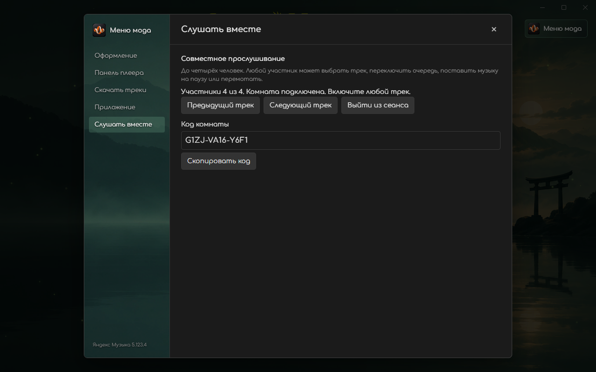
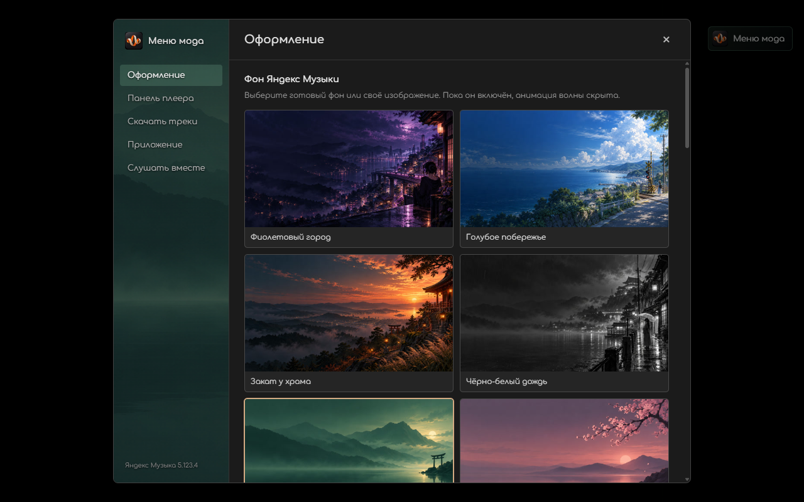

# Яндекс Музыка Мод

**Актуальная версия 1.6.0** для Windows x64 на базе клиента Яндекс Музыки 5.123.4.

[Скачать установщик и portable-версию](https://github.com/EelinLp/Yandex-Music-Mod/releases/latest)

- **Слушать вместе.** До четырёх человек в комнате. Любой участник может выбрать трек, переключить очередь, поставить музыку на паузу или перемотать.
- **Оформление.** Восемь готовых фонов, своё изображение, затемнение, размытие и эффекты под выбранную тему. Шапки артиста, альбома и плейлиста, карточка трека и рамки подстраиваются под фон.
- **Плеер.** Индикатор кодека и качества, мини-плеер, перемешивание треков из «Мне нравится» и выбор источника текстов.
- **Скачивание.** Мод сохраняет формат полученного аудио, включая FLAC, когда он доступен.
- **Шрифты.** Шесть встроенных шрифтов с кириллицей и возможность добавить свой.

## Как запустить

1. Скачайте установщик из последнего релиза и запустите его.
2. Откройте «Яндекс Музыка Мод» через ярлык и войдите в аккаунт.
3. Настройки находятся в меню мода справа вверху. Установленная версия проверяет новые выпуски в разделе **Приложение → Обновления мода**.

Для portable-версии распакуйте ZIP целиком в отдельную папку и запустите `Яндекс Музыка.exe`. Подробности есть в [инструкции запуска](START.md).

## Как слушать вместе

1. Установите одну и ту же актуальную версию мода на все компьютеры.
2. В меню мода откройте **Слушать вместе → Создать комнату** и отправьте код друзьям.
3. Друзья выбирают **Ввести код** и подключаются. В комнате до четырёх человек вместе с ведущим.

## Оформление

Исходники и скрипты сборки лежат в архиве `YandexMusicMod-Source-1.6.0.zip` в [релизе 1.6.0](https://github.com/EelinLp/Yandex-Music-Mod/releases/tag/v1.6.0).
